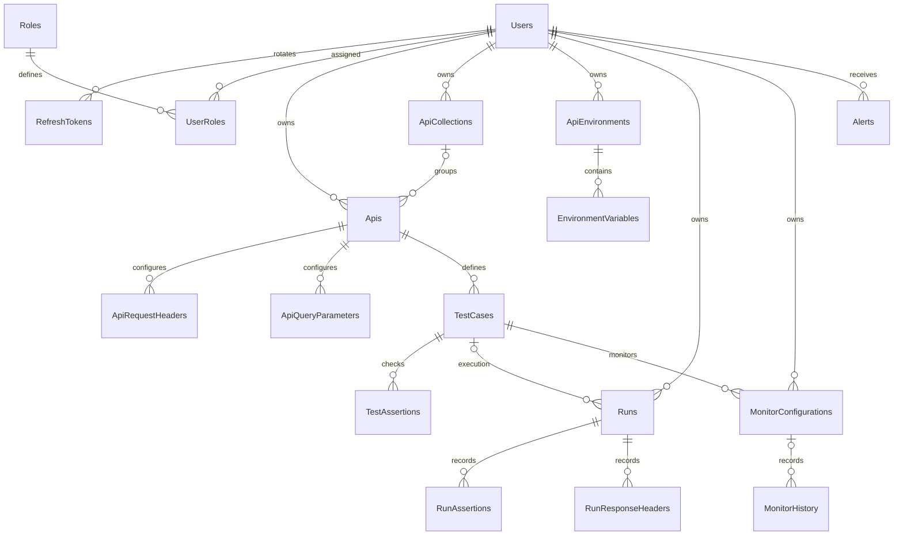

# Database ERD

This diagram reflects the EF Core model and migrations currently in the repository.

Tables are `Users`, `Roles`, `UserRoles`, `RefreshTokens`, `Apis`, `ApiRequestHeaders`, `ApiQueryParameters`, `ApiCollections`, `ApiEnvironments`, `EnvironmentVariables`, `TestCases`, `TestAssertions`, `Runs`, `RunAssertions`, `RunResponseHeaders`, `MonitorConfigurations`, `MonitorHistory`, and `Alerts`. User roles use a normalized many-to-many relationship. Refresh tokens are stored as hashes, have a row version for one-time rotation, and are pruned when revoked or expired sessions are replaced. Test case schema definitions use JSON in `TestCases.SchemaJson`. API credentials, secret request header values, secret query parameter values, and secret environment variables are stored as protected ciphertext; plaintext secrets are never part of response DTOs. Per-run assertion outcomes and safe response headers are normalized child rows. Headers classified as sensitive, including `Set-Cookie`, `Authorization`, cookies, auth tokens, sessions, signatures, and API keys, are excluded from persisted run evidence. Email, role name, refresh token hash and user/expiration or user/revocation state, user/collection name, user/environment name, single active environment per user, environment/variable key, API ownership/collection, API/header/query parameter name, test API, monitor test, monitor history time, run evidence, and alert ownership/time have indexes.

Deletion is explicit: user-owned records cascade; API deletion cascades its headers/tests after run references are nulled; test deletion nulls run references; collection deletion detaches APIs; monitor deletion preserves history by setting its FK to null; environment variables cascade with their environment; run evidence cascades with its run. Run URL/method/body/status values are execution snapshots to preserve history after an API changes. Times are UTC `DateTime` values. AI history is not stored.